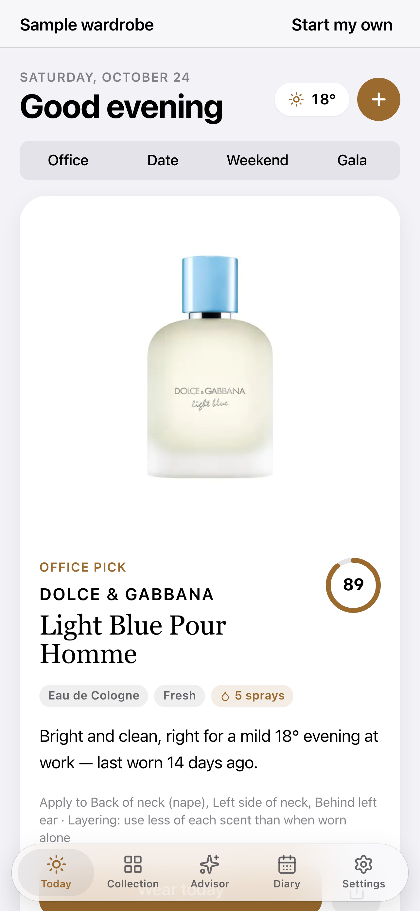

# ScentCap — your fragrance wardrobe, beautifully kept

**Version:** 3.0.0
Add the bottles you own in a tap from 1,325 real fragrances, get a daily pick for the weather and your plans, and keep a wear diary. Apple HIG design, private, works offline.

**Live:** [shamikhahmed.github.io/ScentCap](https://shamikhahmed.github.io/ScentCap/) · [Sample wardrobe](https://shamikhahmed.github.io/ScentCap/?demo=1)

**Site:** [Landing](https://shamikhahmed.github.io/ScentCap/landing.html) · [About](https://shamikhahmed.github.io/ScentCap/pitch.html) · [Presentation](https://shamikhahmed.github.io/ScentCap/presentation.html) · [Privacy](https://shamikhahmed.github.io/ScentCap/privacy.html) · [Terms](https://shamikhahmed.github.io/ScentCap/terms.html) · [Support](https://shamikhahmed.github.io/ScentCap/support.html)



## Features

- **Today** — one pick scored on occasion, weather, dress, mood and rotation, with a plain-language reason and spray guidance; Office / Date / Weekend / Gala in one tap
- **Add** — instant offline search across 1,325 real fragrances with real bottle photos; manual add fallback
- **Collection & detail** — product grid, notes pyramid, best-for meters, bottle level, signature roles, purchase details, wear history
- **Diary & Insights** — one-tap wear check-ins, compliments, streaks, cost per wear, rotation health
- **Layering lab & Travel kit** — best partner from your own wardrobe; pack the right bottles
- **Private** — no account, IndexedDB on device; optional Open-Meteo weather if you add a city

Design system: [DESIGN.md](DESIGN.md). Media: [docs/video](docs/video) · [docs/store](docs/store) · [stories](qa/v7/STORIES.md).

## Quick start

```bash
npm install
npm run dev        # http://localhost:5173/ScentCap/
npm run build
npm run preview    # production preview
npm run generate-icons
npm run test:e2e   # Playwright tests
npm run verify     # lint + unit (incl. catalog integrity) + full e2e (CI gate)
npm run catalog    # rebuild bundled catalog + bottle photos (polite crawler, cached)
```

## Screen gallery

Every screen, mobile + desktop, auto-captured with Playwright:

```bash
npm run gallery        # regenerate docs/screenshots/gallery/
npm run gallery:view   # then open http://127.0.0.1:8771/screen-gallery.html
```

Regenerate on each release so [screen-gallery.html](./screen-gallery.html) stays current.

## Deploy

GitHub Pages workflow deploys from `main` to `https://shamikhahmed.github.io/ScentCap/`.

Set `base: '/ScentCap/'` in `vite.config.ts` (already configured). Marketing pages live in `public/` and ship with the build.

## Tech stack

- React 19 + TypeScript + Vite 8
- Tailwind CSS v4
- React Router · Lucide React · Recharts · sharp (catalog build)
- IndexedDB (`idb`) · vite-plugin-pwa · Playwright

## Privacy

Your wardrobe stays on your device. See [PRIVACY.md](./PRIVACY.md) and [privacy.html](./public/privacy.html).

Built by [Shamikh Ahmed](https://shamikhahmed.github.io/) — part of the Cap portfolio alongside Capricorn Systems.

## Example stories

Illustrative day-in-the-life stories (fictional personas) with screenshots and captions:

- App stories: https://shamikhahmed.github.io/apps/scentcap/
- All Cap stories: https://shamikhahmed.github.io/stories/

