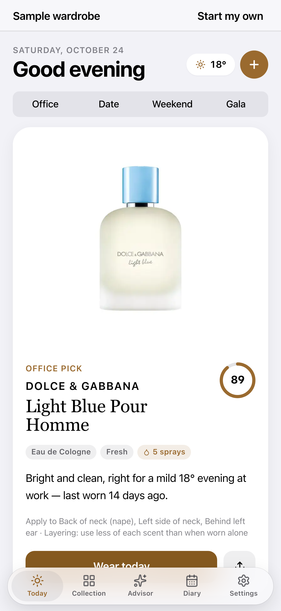
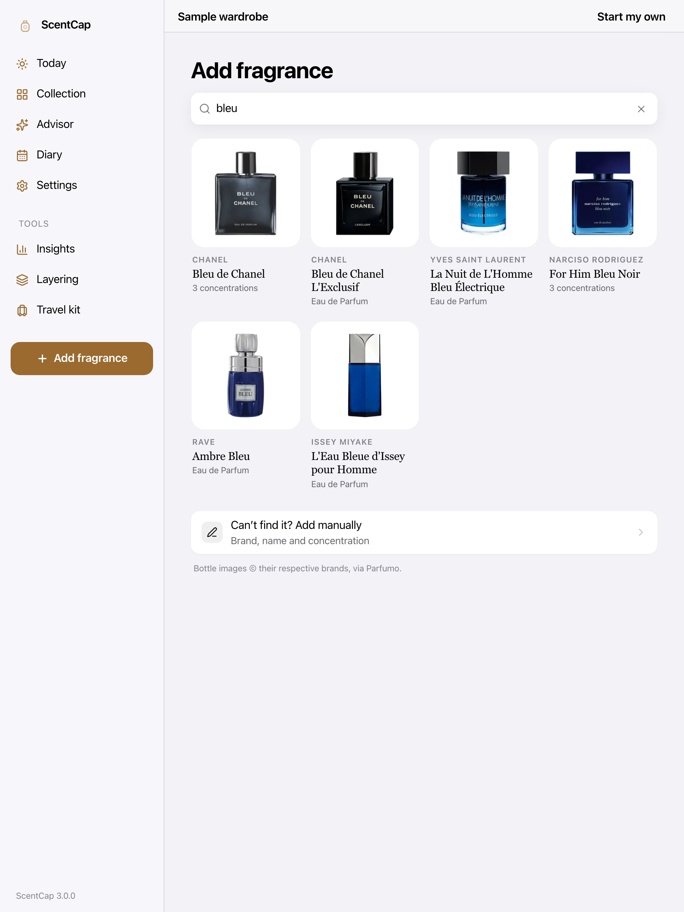

# ScentCap 3.0 — Example stories

> Illustrative stories. **People, names and wardrobes are fictional.** Screens use the built-in sample wardrobe
> (`?demo=1`) with real catalog bottles. Captures: `docs/store/screenshots/` and `docs/screenshots/gallery/`.

## Hira — “Which bottle for a 38° office day?”

*Hira Qureshi, 28, marketing lead in Lahore (fictional).* She owns nine bottles but wears the same two, and heavy ouds feel wrong in the summer heat.

1. **Welcome** — three short screens: what ScentCap does, where she works (Office), how bold she likes it (Balanced). Office Safe switches on automatically.
2. **Today** — she adds her city; each morning the Today card shows one bottle on a white plinth with a match ring and one plain sentence:
   *“Bright and clean, right for a hot 38° morning at work — last worn 12 days ago.”* One tap: **Wear today**.
3. **Evening** — she flips the segmented control to **Date**; the pick changes to something warmer, with spray guidance.
4. **Diary** — a quick check-in sheet after each wear (stars, compliment toggle, note). The month view fills up.

**Outcome:** 6 minutes → 1 minute deciding; rotation from 2 bottles to 7.
> “It knows a 38° Tuesday at work is not the day for oud.”

## James — “Catalogue 60 bottles, properly”

*James Cole, 41, collector in Manchester (fictional).* His spreadsheet has no images; he once blind-bought a bottle he already owned.

1. **Add** — he types `bleu`; results appear instantly from the bundled catalog of 1,300+ real fragrances, each with its real bottle photo — even offline.
2. **Confirm sheet** — pick the concentration (EDP / Parfum), bottle type, optional price and dates. **Add to collection** → lands on the bottle page with a confirmation.
3. **Collection** — a clean grid of real bottles on iPad, filterable by family and sortable by brand.
4. **Insights** — total value, cost per wear, rotation health.

**Outcome:** ~4 minutes → ~20 seconds per bottle logged.
> “Type three letters, tap the bottle, done. And it actually looks like my shelf.”

## Saad — “Two decants and a plan”

*Saad Malik, 24, frequent traveller in Dubai (fictional).* Loves Middle Eastern houses; always over-packs.

1. **Layering lab** — picks a base bottle and gets the best partner from his own wardrobe with order and guidance.
2. **Travel kit** — enters trip dates; ScentCap recommends two travel-friendly bottles and reminds him to check airline rules.
3. **Advisor** — sets Evening · Event · Bold for a dinner and gets a pick plus a spray map.

**Outcome:** 5 bottles packed → 2.
> “Two decants, a layering plan, and I’m out the door.”

## Personas & capture

| Persona | Files | Capture |
|---|---|---|
| Hira Qureshi | `personas/scentcap-hira.*` | `node ../capricorn-tooling/scripts/capture-story.mjs qa/v7/personas/scentcap-hira.steps.json` |
| James Cole | `personas/scentcap-james.*` | same, `scentcap-james.steps.json` |
| Saad Malik | `personas/scentcap-saad.*` | same, `scentcap-saad.steps.json` |
